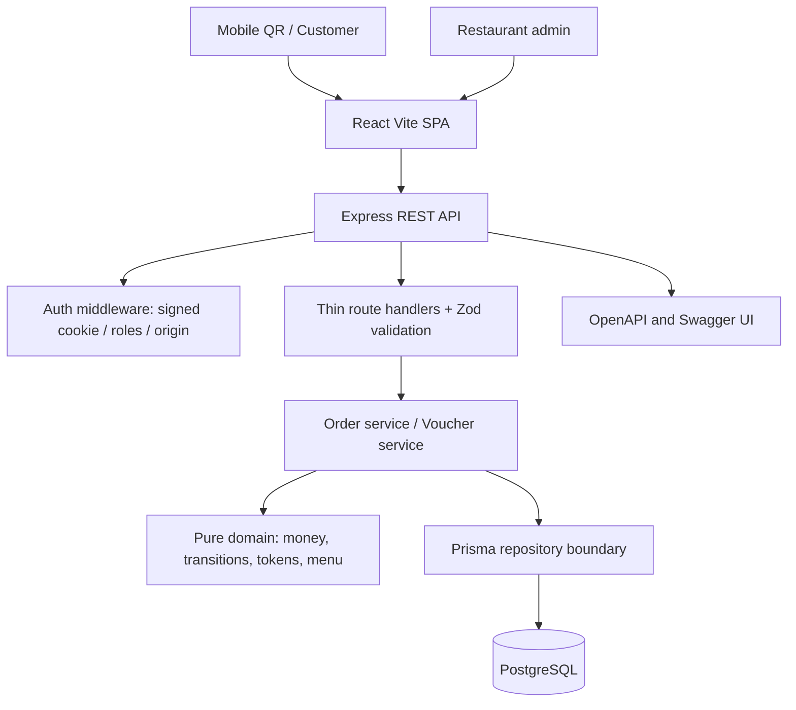
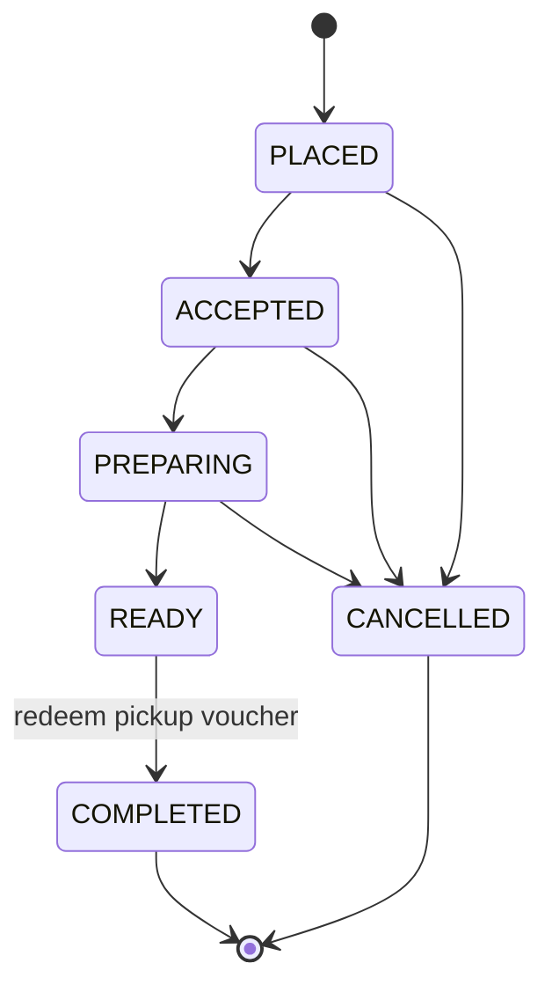

# Persian Food — Architecture (PERN)

## Objectives
- **Clean Architecture first:** the domain package knows nothing about Express, React, or PostgreSQL.
- **Server is the source of truth:** price, tax, availability, order transitions, vouchers, and inventory are never trusted from the browser.
- **Atomic writes:** order creation, stock reservation, invoice issuance and voucher creation execute in one Prisma transaction.
- **Multi-device:** customers can track from any device while signed in. The UI polls the database-backed order endpoint every five seconds (works with multiple API instances).
- **Accessible/responsive:** RTL from 320px to desktop; keyboard-focusable controls, labels and semantic sections.

## Logical architecture

## Ownership by layer

| Layer | Directory | Responsibilities | Must not import |
|---|---|---|---|
| Domain | `packages/domain/src` | Business invariants, calculations, transitions, map/search, cryptographic voucher token | HTTP, UI, Prisma |
| Application | `apps/api/src/services` | Use cases, database transaction orchestration | React |
| Transport | `apps/api/src/routes` | Input parsing, authentication, response status | UI code |
| Infrastructure | `apps/api/src/lib`, `prisma` | Postgres client, database schema | React |
| Presentation | `apps/web/src` | Menu, cart, dashboards, typed HTTP client and polling | DB client, secrets |

## Order processing algorithm

1. Client generates UUID `requestId` for intended checkout and uses it for every retry.
2. API validates payload via Zod, then checks the `(customerId, requestId)` unique constraint.
3. Aggregate repeated products with an in-memory `Map<productId, quantity>`: O(n) time / O(k) memory.
4. Fetch authoritative products, create ID-indexed `Map`, and calculate amounts with integer toman; no client price accepted.
5. Begin SERIALIZABLE database transaction.
6. Reserve each product using conditional SQL update `WHERE stock >= quantity`, aborting transaction if a product is unavailable.
7. Create Order, immutable item snapshots, initial event, Invoice and PickupVoucher in the same transaction.
8. If idempotent duplicate raced, return the existing order. Return 409 for serialization retry requests.

## State machine

`COMPLETED` is deliberately inaccessible from the generic change-status API. The voucher is consumed with a conditional update in a DB transaction. Cancellation restores stock, but only before READY and for unpaid orders; refunds are not implemented.

## Money and documents

- All amounts in integer **toman**. Unit price comes from Product record at checkout; OrderItem preserves a historical price/name snapshot.
- Invoice is generated when the order is placed and shows number, item lines, totals, state and issue date; printable CSS is provided for print-to-PDF.
- Pickup voucher is a cryptographically signed opaque HMAC token: the database stores SHA-256 token hash, never plaintext. Token can be reconstructed by authenticated owner lookup; QR points to public voucher display. Staff redemption requires a separate authenticated staff/admin session, READY order and recorded offline payment.
- `VOUCHER_SECRET` must remain stable across deployments; changing it invalidates previously issued QR tokens.
- Do not assume invoice meets local tax/e-invoice regulations; requirements vary by region.

## Authentication and security

- Passwords hashed using bcrypt (work factor 12), signed 7-day httpOnly session cookie, role checks on every private endpoint, conservative payload validation, request rate limits, Helmet headers, restrict CORS and mutate origin checks.
- For production cross-host deployments, prefer **same-origin `/api` reverse proxy** to preserve first-party cookies. Avoid third-party cookie reliance. Vercel front end needs external persistent API host, e.g. Render/Railway/Fly, and a rewrite/proxy of `/api/*` to that host.
- Ensure HTTPS everywhere, generate random secrets, use non-demo admin password, rotate sessions appropriately, audit staff activity and configure backups before handling real customers.
- Financial operations currently support **offline collection only** (authorized staff mark paid). No payment gateway is integrated.

## Boundaries of v1

No push notifications, persistent analytics, payment gateway, guest checkout, real refund processing, kitchen printer queue, staff audit entity, downloadable server-generated PDF or formal electronic tax invoices. Current status updates are **near-real-time polling** (5s), not WebSockets. Production rollout requires end-to-end tests, load tests, backup/restore drill, role/security audit and database migrations.
