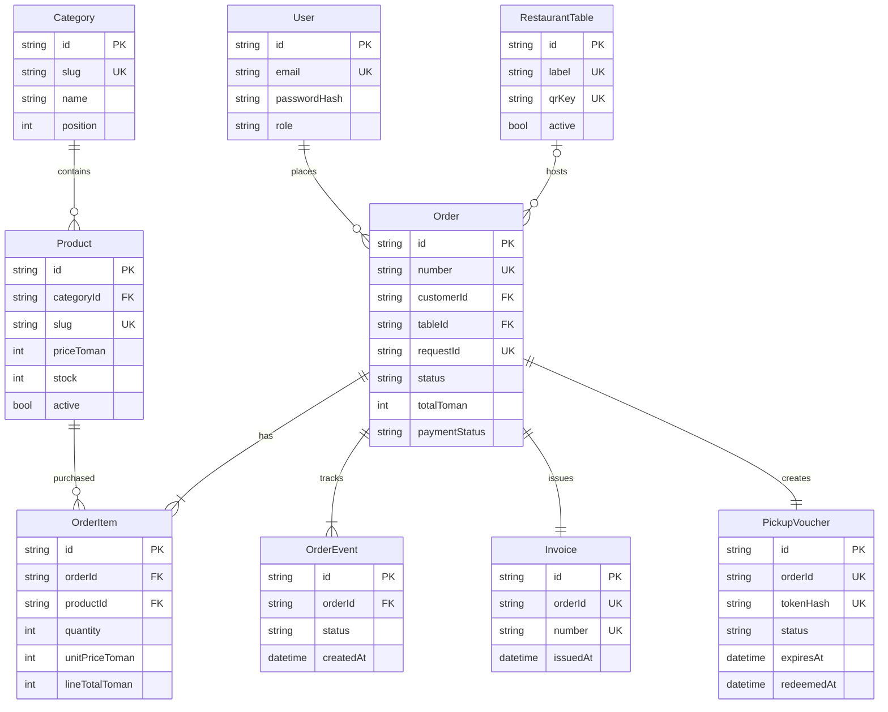

# Data model and ER diagram

The authoritative schema is `apps/api/prisma/schema.prisma` (PostgreSQL, Prisma 6). All major tables and indexes below are represented there.

## Concurrency design

- Database `Order.customerId + requestId` uniqueness implements idempotency.
- Database `PickupVoucher.tokenHash` uniqueness prevents duplicate voucher identity.
- `updateMany` with a current status and expected previous state prevents accidental double state transition.
- Inventory decrements only if enough stock exists, in the same transaction that inserts the order.
- Avoid `prisma db push` for ongoing production updates; create Prisma Migrate migrations and run `prisma migrate deploy` after backup.

## Indexes

`Product(categoryId,active)`, `Order(customerId,createdAt)`, `Order(status,createdAt)`, `OrderEvent(orderId,createdAt)`, and all unique fields. Additional indexes should be chosen using real `EXPLAIN ANALYZE` queries.
